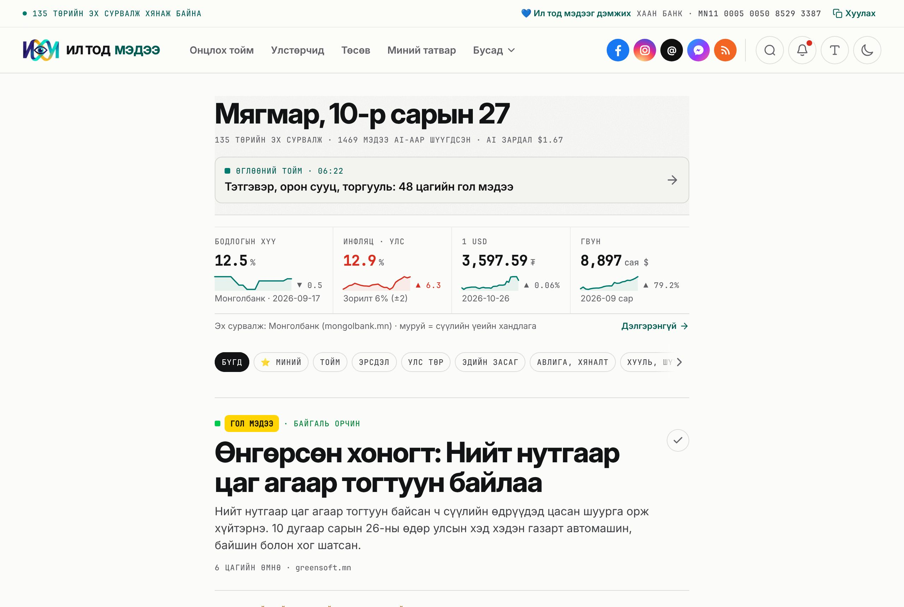

# ИЛ ТОД МЭДЭЭ — төрийн мэдээ, пи-аргүй

[](https://github.com/tmorius-eng/UNENMEDEE/actions/workflows/ci.yml)
[](https://github.com/tmorius-eng/UNENMEDEE/actions/workflows/autonomous-news-pipeline.yml)
[](LICENSE)
[](LICENSE-CONTENT.md)
[](https://iltodmedee.mn)

> 🇲🇳 Монгол Улсын төрийн байгууллагуудын албан ёсны мэдээ, хууль, төсөв, улстөрчдийн хөрөнгийн мэдүүлгийг автоматаар цуглуулж, **баримтыг пи-араас салгадаг**, зарцуулсан цент бүрээ ил тайлагнадаг нээлттэй эхийн мэдээллийн сайт: **[iltodmedee.mn](https://iltodmedee.mn)**.
>
> 🇬🇧 An open-source news site that collects official news, laws, budgets and MPs' asset declarations from Mongolian government websites, **separates verifiable facts from PR spin**, and publishes every cent it spends. [English below](#english).

[](https://iltodmedee.mn)

Сайтыг ажиллуулдаг бүх зүйл энэ репод байна:

- вэб сайт (Next.js),
- 130 гаруй төрийн сайтаас цаг тутам мэдээ цуглуулагч,
- AI шинжилгээ, AI-д өгдөг заавар ([`src/lib/ai/prompts.ts`](src/lib/ai/prompts.ts)),
- бүх автомат ажил ([`.github/workflows/`](.github/workflows)), тэдгээрийн бүртгэл [Actions](https://github.com/tmorius-eng/UNENMEDEE/actions) хэсэгт нээлттэй.

📐 **Техникийн дэлгэрэнгүй:** [docs/ARCHITECTURE.md](docs/ARCHITECTURE.md): систем, өгөгдлийн сан, скрапер, AI pipeline, кластерчлал, аюулгүй байдал, шийдвэрүүдийн шалтгаан (англиар).

## Үндсэн зарчим

- **Баримт эхэнд.** Тоо, ₮ дүн, огноо, хууль, байгууллагыг пи-ар, магтаалаас тусад нь гаргана.
- **Нотлох боломжтой.** Мэдээ бүр эх `.gov.mn` холбоос, цэвэрлэсэн эх текстийн SHA-256 хэштэй.
- **Хэнийг ч буруутгахгүй.** Улстөрчид, төсвийн мэдээлэлд зөвхөн албан ёсны бүртгэлийг эх сурвалжийн холбоостой харуулна. AI-д хүнийг гэмт хэрэгт буруутгахыг хориглосон.
- **Эрсдэлийн оноо = AI-ийн үнэлгээ, баримт биш.** Яаж гардгийг [/method](https://iltodmedee.mn/method) хуудсанд AI-ийн зааврын хамт бүтнээр нь нийтэлсэн.
- **Зар сурталчилгаагүй, хувь хүнийг мөрдөхгүй.** Уншсан мэдээ, дагасан гишүүн зөвхөн таны төхөөрөмжид хадгалагдана. Хандалтыг зөвхөн нэргүй нийт тоогоор (Vercel Web Analytics, cookie-гүй) хэмждэг.
- **0₮ дэд бүтэц.** Vercel Hobby, Supabase Free, GitHub Actions. Төлбөртэй AI сард $3-оос хэтрэхгүй.

## Сайт дээр юу байна

| Хуудас | Юу харуулдаг |
|---|---|
| `/` | Сүүлийн мэдээ, сэдвээр (`/topic/…`), нэг сэдэвт нэг мөр, AI хураангуй, Монголбанкны 4 гол тоо |
| `/digest` | Өдөрт 2 удаа AI редакторын сонгосон 10 чухал мэдээ, долоо хоногийн тоо |
| `/archive`, `/archive/<огноо>` | Өдөр бүрийн бүх мэдээ, сэдвээр нь (сүүлийн 60 хоног) |
| `/source/<домэйн>` | Нэг яам, агентлаг, аймгийн сайтын сүүлийн мэдээ |
| `/place/<аймаг>` | Аймаг, дүүргийн мэдээ ба тойргийн УИХ-ын гишүүд |
| `/laws` | legalinfo.mn-д шинээр гарсан хууль, тогтоол, товч тайлбартай |
| `/officials` | УИХ-ын гишүүд: хөрөнгө орлогын мэдүүлэг (ХАСХОМ), ирц, мэдээнд дурдагдсан нь, "Миний гишүүн" |
| `/officials/companies` | Төрийн өмчит компаниудын орлого, зардал, ашиг, цалингийн сан (Шилэн данс) |
| `/promises` | Засгийн газрын 2024–2028 оны үйл ажиллагааны хөтөлбөрийн 620 зорилт, эх текстээр |
| `/budget` | Улсын төсөв 1990 оноос, зарлага, орлого, өр, аудитын дүгнэлт |
| `/tax` | Цалингийн татвар тооцоолуур: ХХОАТ, НДШ, НӨАТ юунд зарцуулагддаг вэ |
| `/data` | Монголбанкны ханш, инфляц, бодлогын хүү, opendata.mn-ийн өгөгдөл |
| `/changes` | Төрийн сайт нийтэлснийхээ дараа засварласан, устгасан мэдээ |
| `/my` | Таны дагасан сэдэв, аймаг (бүртгэлгүй, зөвхөн таны төхөөрөмжид) |
| `/search` | Мэдээ, гишүүдээс хайх |
| `/transparency` | AI дуудлага бүрийн токен, долларын зардал, орлого |
| `/method` | Арга зүй: AI яаж ажилладаг, эрсдэлийн оноо, AI-ийн заавар |

## Дагах

Тойм, чухал мэдээ автоматаар эдгээр сувагт гардаг: [Facebook](https://www.facebook.com/profile.php?id=61595785044734), [Instagram](https://www.instagram.com/iltodmedee.mn/), [Threads](https://www.threads.com/@iltodmedee.mn), [Discord](https://iltodmedee.mn/discord) (сувгийг өөрийн server-тээ Follow хийх, `/toim` `/haih` `/aimag` командууд), [RSS](https://iltodmedee.mn/feed.xml). Сайт дээрх 🔔 товчоор утсандаа мэдэгдэл авна.

## AI түлхүүр яаж хадгалагддаг вэ

- Кодонд **ямар ч түлхүүр, нууц үг байхгүй**. AI-ийн түлхүүр, `DATABASE_URL` зөвхөн GitHub Actions secrets болон Vercel-ийн орчны хувьсагчид байна. `.env*` файлууд git-д ордоггүй (`.env.example` л байна).
- Үнэгүй AI-ууд (Groq, NVIDIA NIM, Requesty, OpenRouter) ээлжлэн ажиллана, дараа нь Z.ai. Gemini: төлбөр холбоогүй Google project-ийн түлхүүр бол үнэгүй (`GEMINI_FREE_TIER=true`); төлбөртэй түлхүүр бол үнэгүйнүүдийн дараа, зөвхөн хамгийн хямд `gemini-2.5-flash-lite` загвараар, мөнгөний хязгаар дотор. Зураг үүсгэх загвар хэзээ ч ашиглахгүй. Төлбөртэй (DeepSeek, Grok) нь сард `AI_MONTHLY_BUDGET_USD` ($3), өдөрт `AI_DAILY_BUDGET_USD` ($0.30)-оос хэтэрвэл автоматаар зогсоно ([`src/lib/ai/limits.ts`](src/lib/ai/limits.ts)).
- Дуудлага бүр `ai_usage_logs`-д бичигдэж [/transparency](https://iltodmedee.mn/transparency)-д харагдана.

## Өөрийн компьютер дээр ажиллуулах

```bash
git clone https://github.com/tmorius-eng/UNENMEDEE && cd UNENMEDEE
npm install                 # Node.js 24
npm run demo                # http://localhost:3000: жишээ өгөгдөлтэй бүтэн сайт, DB болон API түлхүүр хэрэггүй
```

`npm run demo` нь `tests/fixtures`-д хадгалсан **бодит** төрийн мэдээ, УИХ-ын гишүүд, ХАСХОМ мэдүүлэг, Монголбанк, төсвийн өгөгдлийг процесс доторх Postgres (PGlite, `.demo-db/`) руу ачаалж сайтыг асаана. Хураангуй нь эхний өгүүлбэрүүд ("AI ажиллаагүй"); `.env`-д үнэгүй `GROQ_API_KEY` тавиад `DATABASE_URL=pglite:./.demo-db npm run ai:process` хийвэл AI хураангуй үүснэ. Дахин эхнээс нь: `.demo-db/`-г устгана.

Өгөгдөлтэй ажиллуулах:

```bash
cp .env.example .env        # DATABASE_URL, нэг үнэгүй AI түлхүүр (GROQ_API_KEY), ADMIN_SECRET_PASSWORD
npm run db:migrate && npm run db:seed
npm run scrape -- --source mlsp.gov.mn --limit 2
npm run ai:process -- --limit 2
```

API түлхүүрээ шалгах: `npm run ai:process -- --sample`. Өгөгдлийн сангүй туршилт: `npm run scrape -- --dry-run --source parliament.mn --limit 2`.

**`DATABASE_URL`:** Supabase төсөл → **Connect** → **Transaction pooler** (порт 6543). Migration-д **Session pooler** (порт 5432)-ийг `DATABASE_URL_DIRECT` нэрээр нэмж болно.

**Автоматжуулалт:** репо → Settings → Secrets and variables → Actions хэсэгт `DATABASE_URL` болон дор хаяж нэг AI түлхүүр нэмэхэд мэдээ цаг тутам шинэчлэгдэнэ. Vercel дээр мөн адил (нэмээд `ADMIN_SECRET_PASSWORD`, 12+ тэмдэгт).

## Хувь нэмэр оруулах

- **Эх сурвалж санал болгох:** [issue нээх](https://github.com/tmorius-eng/UNENMEDEE/issues/new/choose) → "Эх сурвалж санал болгох". Эсвэл [`src/lib/sources.ts`](src/lib/sources.ts)-д нэмээд PR илгээнэ. JSON API-тай сайтад [`src/lib/scraper/adapters/`](src/lib/scraper/adapters)-д adapter бичнэ.
- **Алдаа мэдэгдэх:** AI хураангуй, тоо буруу байвал эх сурвалжийн холбоосыг хавсаргаад issue нээнэ үү.
- **Код:** PR бүр `npm run check` (typecheck + lint + 330+ unit test) болон `npm run build` (нууц түлхүүргүй) давах ёстой. Алхам алхмаар заавар: [CONTRIBUTING.md](CONTRIBUTING.md). Архитектурын дүрэм [`CLAUDE.md`](CLAUDE.md)-д бий.

## Эзэмшигчийн шалгах хуудас

Сайт хүнгүйгээр ажиллана: мэдээ цаг тутам, тойм өдөрт хоёр удаа, УИХ-ын гишүүд долоо хоног бүр, сонгуулийн дараа ч өөрөө шинэчлэгдэнэ. Ямар нэг зүйл зогсвол **watchdog** GitHub issue нээж танд имэйл илгээнэ: мөр бүр юу зогссон, аль secret/хуудсыг засахыг хэлнэ. Хүний гар шаардлагатай цорын ганц зүйлс:

| Хэзээ | Юу хийх |
|---|---|
| Одоо, нэг удаа | `age-keygen`-ээр нөөцийн түлхүүр үүсгэж `BACKUP_AGE_PUBLIC_KEY` secret-д хийх ([docs/BACKUP.md](docs/BACKUP.md)). Чатад хуулсан Vercel токеныг хүчингүй болгох. |
| Watchdog issue ирэхэд | Мөрийг уншаад заасан secret, хувьсагч, хуудсыг засах. Засагдмагц issue өөрөө хаагдана. |
| Улиралд нэг удаа | Нөөц хуулбарыг нэг удаа тайлж шалгах (docs/BACKUP.md, 3-р алхам). Dependabot-ын PR-уудыг CI ногоон бол нэгтгэх. /admin-д сарын орлого (зар, хандив) оруулах: оруулаагүй сар «бүртгээгүй» гэж харагдана. |
| Жил бүр | Porkbun домэйн сунгалт. Meta Data Use Checkup. `VERCEL_TOKEN`-ийг шинэчлэх. Watchdog сануулбал `POPULATION`, `RATES_CHECKED`, `GOVERNMENTS_VERIFIED_THROUGH`-ийг шинэчлэх. |
| Засгийн газар солигдоход | `src/lib/budget/governments.ts`-д шинэ Ерөнхий сайдыг нэмж `GOVERNMENTS_VERIFIED_THROUGH`-ийг шилжүүлэх. Түүнээс өмнө /budget шинэ онд «—» гэж үнэнээр нь харуулна. |
| 2027-10 | audit.mn-ийн `certs/rapidssl-tls-rsa-ca-g1.pem` 2027-11-02-нд дуусна (watchdog 60 хоногийн өмнө сануулна). |
| 2028-04 | Node 24-ийн дэмжлэг дуусна: workflow-ууд болон Vercel дээр `node-version`-ийг ахиулах. |
| 2028-06 УИХ-ын сонгууль | Юу ч хийх шаардлагагүй: шинэ гишүүд дараагийн sync-ээр орж, тойргийн нэр өөрчлөгдсөн ч аймгийн хуудсууд гишүүдээ олно. Watchdog идэвхтэй гишүүн 100-аас цөөн эсвэл гишүүнгүй аймаг гарвал хэлнэ. |
| 2028-07 | Шинэ Засгийн газрын хөтөлбөр батлагдсаны дараа `npm run promises:import`. Тэр хүртэл /promises «өмнөх хөтөлбөр» гэж бичнэ. |
| Ерөнхийлөгчийн сонгууль | Юу ч хийх шаардлагагүй: сайтын аль ч хэсэг Ерөнхийлөгчөөс хамаардаггүй. |
| Supabase төсөл алдагдвал | Шинэ төсөл → secret-ууд → `db:migrate` → `db:restore` (docs/BACKUP.md). VAPID түлхүүрийг хэзээ ч шинээр бүү үүсгэ. |
| Сошиал токен дуусвал | Шинэ токеныг secret-д хийхэд хадгалагдсан токеныг өөрөө солино ([docs/FACEBOOK.md](docs/FACEBOOK.md)). |

## Холбоо барих

Сайттай холбоотой санал хүсэлт, алдаа, шинэ эх сурвалж, хамтын ажиллагаа, хэвлэл мэдээллийн асуудлаар **[info@iltodmedee.mn](mailto:info@iltodmedee.mn)** хаягаар бичээрэй. Кодын алдаа, санааг [issue](https://github.com/tmorius-eng/UNENMEDEE/issues) болгон нээж болно.

## Аюулгүй байдал

Эмзэг байдал олвол **нээлттэй issue бүү бичээрэй**: [SECURITY.md](SECURITY.md)-ийн дагуу нууцаар мэдэгдэнэ үү.

- `main` салбар хамгаалагдсан: зөвхөн PR-ээр, CI ногоон үед нэгтгэнэ.
- GitHub Actions-ууд commit SHA-аар бэхлэгдсэн, `GITHUB_TOKEN` зөвхөн уншина.
- Dependabot долоо хоног бүр шинэчлэл санал болгоно. CodeQL, secret scanning, push protection асаалттай.
- Аюулын загвар (threat model): нэг DB хэрэглэгч яагаад хангалттай, админ хамгаалалт, prompt injection-оос хамгаалах арга. Дэлгэрэнгүйг [SECURITY.md](SECURITY.md)-с үзнэ үү.

---

<a id="english"></a>

## English

### How it works

The full technical write-up, with diagrams, the data model, algorithms and design trade-offs, is in **[docs/ARCHITECTURE.md](docs/ARCHITECTURE.md)**. A short version:

```
GitHub Actions (hourly, free on public repos)
 ├─ npm run scrape          130+ sources (curated + discovered), least-recently-scraped first, 30-min budget
 │   ├─ JSON APIs / feeds   opendata.gov.mn, parliament.mn, legalinfo.mn, police.gov.mn, mongolia.gov.mn RSS
 │   ├─ HTTP pass (Crawlee) robots.txt (8 hosts at a time) → WordPress REST API → RSS → link harvesting → Readability
 │   └─ Browser pass        headless Chromium only for JavaScript-rendered sites
 │      → SHA-256 dedup → clean text only → articles
 └─ npm run ai:process
     ├─ Budget guard                            paid providers stop at $3/month, $0.30/day; Grok ≤ 5 calls/day
     ├─ Tier 1  4 free providers in turn → Z.ai → Gemini → DeepSeek   free first; facts, spin, risk 0-100
     ├─ Tier 2  Grok → Gemini → Groq → …        only when risk ≥ 65: investigative analysis
     ├─ Fallback                                first sentences if every provider fails for 24 h
     └─ ai_usage_logs                           exact tokens and USD for every call
GitHub Actions (08:07 and 20:07 Ulaanbaatar)
 ├─ data:sync / macro:sync / budget:sync   opendata.mn, Mongolbank, NSO, Шилэн данс, World Bank, audit.mn
 ├─ digest                                 rank the last 12 h without AI → editor model picks 10 → /digest
 ├─ push:send / social:post                Web Push + Facebook, Instagram, Threads, Telegram, Discord (docs/FACEBOOK.md)
 └─ db:prune                               old bodies → excerpts, old unpublished rows deleted (bounded DB)
Weekly: officials:sync (MPs + ХАСХОМ declarations), sources:discover, sources:recheck (edited or deleted posts).
Daily: watchdog, keepalive, Vercel deployment cleanup. Weekly: encrypted database backup (`docs/BACKUP.md`).
Vercel (Next.js 16, Cache Components) reads Supabase and renders the public site + /admin.
```

### Repository map

| Path | What |
|---|---|
| `CLAUDE.md` | Architecture rules for contributors and AI agents |
| `src/db/schema.ts`, `drizzle/` | Drizzle schema and SQL migrations |
| `src/lib/sources.ts` | Curated source list and discovery hubs |
| `src/lib/scraper/` | robots.txt parser, polite fetch (8 s per host), extractor, adapters, two-pass crawler |
| `src/lib/ai/` | Provider router with cost logging, budget guard, prompts, schemas, clustering, digest |
| `src/lib/officials/`, `budget/`, `soe/`, `mongolbank/`, `opendata-mn/` | Civic-data clients and parsers (each unit-tested on saved fixtures) |
| `src/lib/queries.ts` | Cached read model for the public site |
| `src/lib/social/` | Facebook, Instagram, Threads, Telegram and Discord posting, the Messenger and Discord bots |
| `src/lib/places.ts`, `src/lib/promises/` | Aimags, districts and their constituencies; the Government action programme |
| `src/lib/seo.ts`, `src/lib/structured-data.ts`, `src/lib/archive.ts` | Which pages are indexed, JSON-LD builders, the day archive |
| `src/app/` | Pages (see the table above) and `/admin` |
| `.github/workflows/` | Pipeline, digest + data sync, officials, discovery, source re-check, social posts, watchdog, keepalive, backup, Vercel cleanup, maintenance, CI |

### Audit it yourself

- **Every number on `/transparency` comes from SQL.** `ai_usage_logs` stores provider, model, tokens and the USD cost from the public price table in `src/lib/ai/pricing.ts`.
- **Every article links to its `.gov.mn` original** and shows the SHA-256 of the cleaned text. Edits are labelled on the page; the hash keeps proving the original scrape.
- **The prompts are public**, both in `src/lib/ai/prompts.ts` and rendered verbatim on `/method`.
- **Risk scores are AI estimates, not facts.** The model scores 0-100 by the published rubric; our code, not the model, sets the "high" threshold (65). Prompts forbid asserting crimes.
- **Pipeline logs are public** in the Actions tab.

### Honest limits

- Free GitHub Actions minutes require a public repository; an hourly pipeline needs far more than a private repo's free quota.
- Some sites block cloud IPs or sit behind a Cloudflare browser challenge (tender.gov.mn, president.mn), and a few cannot be reached from outside Mongolia at all (mof.gov.mn, ulaanbaatar.mn, customs.gov.mn). They fail gracefully and back off; we never try to get around Cloudflare.
- About a third of the stories are minor notices (trainings, events, dataset listings). They stay on the site but are `noindex` and out of the sitemaps, so search engines see the substantial ones.
- AI output can be wrong. Summaries name the model that wrote them, and every page links the official source.

### Owner checklist

The site runs unattended: news hourly, digests twice a day, MPs weekly (elections included). When anything stops, the **watchdog** opens a GitHub issue (emailed to the owner) naming what stopped and which secret or page to fix. The only manual items:

| When | What |
|---|---|
| Now, once | Create the backup key with `age-keygen` and store the public key in `BACKUP_AGE_PUBLIC_KEY` (`docs/BACKUP.md`). Revoke the Vercel token that was pasted in chat. |
| On a watchdog issue | Fix what its lines name; the issue closes itself once healthy. |
| Quarterly | Decrypt one backup as a drill. Merge green Dependabot PRs. Enter monthly income in /admin (months left empty read "not entered"). |
| Yearly | Renew the Porkbun domain, Meta Data Use Checkup, rotate `VERCEL_TOKEN`; update `POPULATION`, `RATES_CHECKED`, `GOVERNMENTS_VERIFIED_THROUGH` when the watchdog asks. |
| New government | Add the Prime Minister in `governments.ts` and move `GOVERNMENTS_VERIFIED_THROUGH`; until then /budget shows "—" for unverified years. |
| 2027-10 | `certs/rapidssl-tls-rsa-ca-g1.pem` (audit.mn) expires 2027-11-02; the watchdog warns 60 days ahead. |
| 2028-04 | Node 24 reaches end of life: bump `node-version` in the workflows and on Vercel. |
| June 2028 election | Nothing: new MPs arrive with the next sync and place pages match redrawn constituencies; the watchdog flags fewer than 100 active MPs or a place without MPs. |
| July 2028 | Run `npm run promises:import` once the new programme is approved; /promises says "previous programme" meanwhile. |
| Presidential election | Nothing: no part of the site depends on the President. |
| Supabase project lost | New project → secrets → `db:migrate` → `db:restore` (`docs/BACKUP.md`); never regenerate the VAPID keys. |
| A social token dies | Put a new token in its secret; the stored one is replaced (`docs/FACEBOOK.md`). |

### Contributing

```bash
npm run demo    # the full site on real sample data (PGlite, no database server, no API keys)
npm run check   # typecheck + lint + 330+ unit tests (no secrets needed)
npm run build   # must pass without DATABASE_URL
```

Changes land through pull requests with CI green; see [CONTRIBUTING.md](CONTRIBUTING.md). Report vulnerabilities privately (see [SECURITY.md](SECURITY.md)).

### Contact

Feedback, corrections, new sources, partnerships and press: **[info@iltodmedee.mn](mailto:info@iltodmedee.mn)**. Code issues and ideas: [GitHub issues](https://github.com/tmorius-eng/UNENMEDEE/issues).

## License

- **Code:** [MIT](LICENSE).
- **Content we produce** (AI summaries, digests, computed data, charts, RSS): [CC BY 4.0](LICENSE-CONTENT.md). Reuse it freely, commercially too, crediting "ИЛ ТОД МЭДЭЭ (iltodmedee.mn)" with a link.
- **Original government texts** belong to their publishers; every article links to its official source.

Код MIT; манай бэлтгэсэн агуулга CC BY 4.0: эх сурвалжаа **iltodmedee.mn** гэж холбоостой дурдаад чөлөөтэй ашиглаарай.
