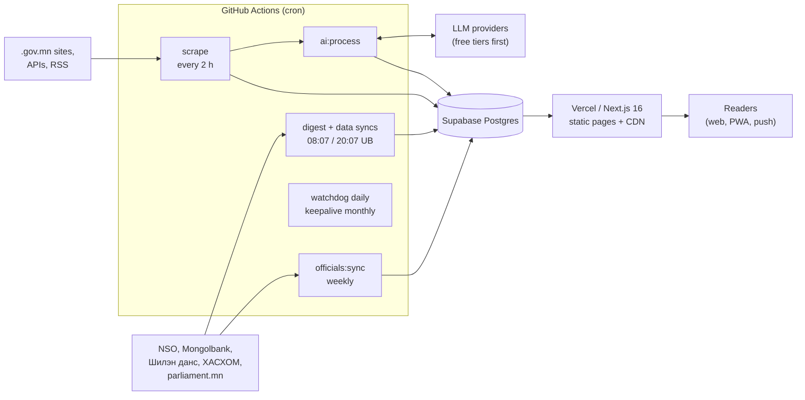
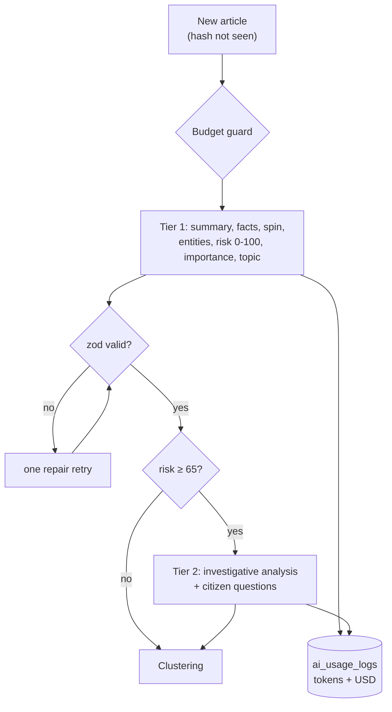

# Architecture

How [iltodmedee.mn](https://iltodmedee.mn) works, end to end. Everything here runs on free tiers:
GitHub Actions (public repo), Vercel Hobby and Supabase Free (500 MB Postgres). The only paid
part is optional AI, capped at $3 a month.

- [System overview](#system-overview)
- [Data model](#data-model)
- [Scraping](#scraping)
- [AI pipeline](#ai-pipeline)
- [Clustering and the digest](#clustering-and-the-digest)
- [Civic data](#civic-data)
- [Web app and rendering](#web-app-and-rendering)
- [Push notifications](#push-notifications)
- [Security model](#security-model)
- [Running unattended](#running-unattended)
- [Testing](#testing)
- [Design decisions and trade-offs](#design-decisions-and-trade-offs)

## System overview



There is no long-running server. All writes happen in scheduled GitHub Actions jobs; the website only
reads (plus a few rate-limited server actions for push subscriptions and the admin area). The
database is the only shared state between the two halves.

| Job | Schedule | Script | Writes |
|---|---|---|---|
| News pipeline | every 2 h | `scripts/run-scraper.ts`, `scripts/process-ai.ts` | `articles`, `clusters`, `ai_usage_logs` |
| Digest + data | 08:07, 20:07 Ulaanbaatar | `digest`, `data:sync`, `macro:sync`, `budget:sync`, `db:prune` | `digests`, `open_datasets`, `indicator_snapshots` |
| Officials | weekly | `officials:sync` | `politicians`, `asset_declarations` |
| Source discovery | weekly | `sources:discover` | `sources` |
| Watchdog | daily | `npm run health` | a GitHub issue when something is stale |
| Keepalive | monthly | GitHub API | re-enables scheduled workflows |
| CI | every PR | `npm run check`, `npm run build`, dependency review, CodeQL | nothing |

## Data model

Drizzle ORM schema in [`src/db/schema.ts`](../src/db/schema.ts), hand-written idempotent SQL
migrations in [`drizzle/`](../drizzle) (`IF NOT EXISTS` everywhere, so a rerun is harmless).

| Table | Holds |
|---|---|
| `sources` | Every monitored site: domain, category (portal / ministry / agency / local), scrape state, `consecutive_failures` for back-off |
| `articles` | Cleaned text (never raw HTML), `content_hash` (SHA-256), AI fields (`tldr`, `facts`, `spin_detected`, `neutrality_score`, `risk_score`, `importance_score`, `topic`, `extracted_entities`), deep analysis, cluster id, prune / fallback / notification markers |
| `clusters` | Cross-source stories: title, synthesis, article count |
| `ai_usage_logs` | One row per LLM call: provider, model, tier, prompt/completion tokens, USD cost, success, error |
| `digests` | "Онцлох тойм" editions (12 h and 30 d) as JSON |
| `politicians`, `asset_declarations` | MPs from parliament.mn and their yearly ХАСХОМ declarations (₮) |
| `open_datasets` | opendata.mn metadata and small computed highlights (never raw rows) |
| `indicator_snapshots` | One JSON document per external source (`mongolbank`, `budget_nso`, `shilendans`, `soe_finance`, …) |
| `push_subscriptions` | Web Push endpoints and followed MPs |
| `social_posts` | What was posted to the Facebook page (one row per platform + digest/article, so nothing posts twice) |
| `app_settings` | Server-side settings shared by Vercel and Actions (VAPID keys, donation account) |
| `transparency_ledger` | Income and costs shown on `/transparency` |

Size budget: about 6 KB per article. Bodies older than 180 days are cut to a 600-character
excerpt (`db:prune`), so the database stays near one retention window, far under 500 MB.

## Scraping

Library code in [`src/lib/scraper`](../src/lib/scraper), entry point `scripts/run-scraper.ts`.

**Politeness.** Our own robots.txt parser ([`robots.ts`](../src/lib/scraper/robots.ts)) and an 8-second
minimum delay per host ([`http.ts`](../src/lib/scraper/http.ts)). The User-Agent names the site.
Sites behind a Cloudflare browser challenge are marked inactive; we never try to get around it.

**Order of attempts per source:**

1. **Adapters** ([`adapters/`](../src/lib/scraper/adapters)) for sites with a public API or feed:
   opendata.gov.mn, parliament.mn, legalinfo.mn (`POST /mn/ajaxLlist/`), police.gov.mn, and zasag.mn via
   the `mongolia.gov.mn` RSS feed. These are the same JSON endpoints the sites' own pages call.
2. **HTTP pass** ([`crawl.ts`](../src/lib/scraper/crawl.ts), Crawlee + cheerio): WordPress REST API
   (the base the page advertises in `<link rel="https://api.w.org/">`, so plain-permalink installs
   with `?rest_route=` work too; a post without `link` is reached as `/?p=<id>`), then RSS/Atom, then
   scored link harvesting from news listing pages ([`links.ts`](../src/lib/scraper/links.ts): article
   ids in the query string such as `/?p=123` or `mn.php?page=40&news=1633` count, pagination does
   not), with the homepage as a last resort. A splash page with fewer than three article links is
   followed one hop into its news sections (`/home`, `/j`, `/c/medee…`, anchors reading "Мэдээ").
   404/410 pages are never stored; a listing that was reached but yielded nothing is a failure.
3. **Browser pass**: headless Chromium (Playwright) only for sources whose news list needs JavaScript.

**Extraction.** Mozilla Readability on jsdom, with a cheerio fallback
([`extract-safe.ts`](../src/lib/scraper/extract-safe.ts)). The text is cleaned, capped and hashed with
SHA-256; an already-seen hash is skipped before any AI call, so duplicate press releases cost nothing.

**Headlines and dates.** Some sites put their own name on every page ("Мэдээ | ТТХГ"), so the
headline is the first candidate (Readability, `og:title`, `<h1>`, `<title>`) that is not a section
word, the site's name or abbreviation, or a title the same site already used this month; otherwise the
first sentence of the text ([`titles.ts`](../src/lib/scraper/titles.ts)); headlines a site publishes in
capitals are stored in sentence case, keeping abbreviations and initials. The date comes from meta
tags, JSON-LD, `<time>`, the URL, or a date printed between the headline and the body (dates in
"related news" lists below the body are ignored). Machine dates without a time zone are Ulaanbaatar
time; a `<time>` more than a year older than the newest one on the page is a stray stamp in the page
chrome and is skipped; a date printed in the text is only trusted when it is less than a year old
(older ones are quoted resolution dates). A page with no date is flagged `date_unknown` and shown as
"Огноо тодорхойгүй"; if its text only mentions years before last year it is an archive page and is
not published. Dated items older than 60 days (`MAX_AGE_DAYS`) are stored unpublished too, so a
crawler that reaches an archive never surfaces 2009 resolutions as today's news (a `--days` backfill
widens the window to what it asked for).

**Scheduling.** Sources rotate least-recently-scraped first inside a 30-minute budget. A failing source
backs off 2^n hours. From GitHub's US runners `.gov.mn` hosts are ~250–300 ms away, so
[`net-setup.ts`](../src/lib/scraper/net-setup.ts) raises Node's happy-eyeballs per-address timeout from
250 ms to 3 s (the default made 57 sources fail at once with an empty `AggregateError`).

**Discovery.** `sources:discover` reads hub pages (government portals, aimag lists) weekly and adds new
`*.gov.mn` / `*.khural.mn` sites.

**Re-checking sources.** Government sites sometimes edit or delete a post after publishing it.
`source-recheck.yml` (weekly, `npm run sources:recheck`) fetches the last 30 days of articles again
(robots.txt, 8 s per host) with the same text getter that first read them. Hashes are never compared,
because widgets and counters change every page. Instead [`recheck.ts`](../src/lib/scraper/recheck.ts)
asks how many sentences of our stored copy are still on the page. Below 80 %, or a sentence whose
numbers changed, marks the article `changed` and stores the before/after sentences (`source_diff`,
capped at 12). A 404/410, or a redirect to the homepage or another site, on two checks at least six
days apart marks it `gone`. Timeouts, 5xx and failed extraction prove nothing and are skipped. The
article page shows the diff, and `/changes` lists every case. A manual run is a dry run by default.

## AI pipeline

Library code in [`src/lib/ai`](../src/lib/ai); the prompts are public in
[`prompts.ts`](../src/lib/ai/prompts.ts) and rendered verbatim on [/method](https://iltodmedee.mn/method).



**Provider chains** ([`router.ts`](../src/lib/ai/router.ts)), all through the `openai` SDK with a
custom `baseURL` except Gemini (native `generateContent`):

- Tier 1: Groq, NVIDIA NIM and Requesty (free Gemma) take turns → Gemini → DeepSeek → Ollama. Gemini is free with a key from a Google project without billing (`GEMINI_FREE_TIER=true`, then it sits right after Groq); a billed key comes after the free providers and uses only `gemini-2.5-flash-lite` inside the USD budget. Image/video/speech models are refused.
- Tier 2: xAI Grok → Gemini → Groq → NVIDIA → Requesty → DeepSeek → Ollama (billed Gemini moves behind the free ones)

A provider that errors, rate-limits (one retry after a 429) or returns invalid JSON hands over to the
next. Chains can be overridden with `AI_TIER1_CHAIN` / `AI_TIER2_CHAIN`.

**Structured output.** JSON mode, then zod schemas ([`schemas.ts`](../src/lib/ai/schemas.ts)) with one
repair retry. Scores are clamped; an unknown `topic` becomes null; ₮ amounts found by regex are merged
into the entities.

**The risk score is an estimate.** The model scores 0–100 by a rubric in the prompt. The "high"
flag is computed by our code (`risk_score >= 65`), never taken from the model, and the prompts forbid
asserting that anyone committed a crime.

**Cost control** ([`limits.ts`](../src/lib/ai/limits.ts)). A guard runs before every call:
- Paid providers stop at `AI_MONTHLY_BUDGET_USD` ($3) and `AI_DAILY_BUDGET_USD` ($0.30), summed from
  `ai_usage_logs`.
- Every provider has a daily call cap (Grok: 5) and optional per-minute throttling.
- Free providers keep working after the money runs out.
- Input is cut to 4,000 characters (tier 1) and 8,000 (tier 2); opendata.gov.mn datasets are
  summarized by rules with 0 tokens.

Every call, successful or not, is logged with its tokens and USD cost (a provider-reported cost wins
over our price table in [`pricing.ts`](../src/lib/ai/pricing.ts)). `/transparency` is a plain SQL view
of that table.

**Fallback.** If an article is still unsummarized after 24 h (every provider down or out of quota), its
first sentences become the summary, labelled "AI ажиллаагүй" on the page
([`fallback.ts`](../src/lib/ai/fallback.ts)).

## Clustering and the digest

**Clustering** ([`clustering.ts`](../src/lib/ai/clustering.ts)) groups the same story from different
sources, with no embeddings or extra API calls:

- Mongolian is agglutinative (тендер, тендерийн, тендерт), so words are cut to 6-letter stems after
  removing stopwords.
- similarity = max(bigram-shingle Jaccard, 0.7 × stem Jaccard + 0.3 × entity Jaccard), the second
  term only when stems already overlap ≥ 0.25.
- Join threshold 0.45, cross-source only, 7-day window. A cluster synthesis is written only at growth
  milestones, not on every new member.

**Digest** ([`digest.ts`](../src/lib/ai/digest.ts)), twice a day:

1. Rank without AI:
   `importance + 0.3 × risk + 8 × min(other sources, 4) + source-category weight + 10 for national sites`,
   one article per cluster.
2. Send the top 40 (70 for the monthly edition) to an editor model, which picks 10 (20) and writes a
   headline and "why it matters" for each.
3. Drop any id the model invented. Without AI, the rule-based ranking is published as is.

## Civic data

Facts only: every number links to its official source and no copy accuses anyone. Each source has a
parser unit-tested against a saved real response in [`tests/fixtures`](../tests/fixtures).

| Page | Source | Code |
|---|---|---|
| `/officials` | parliament.mn member API + IAAC ХАСХОМ declarations API | [`src/lib/officials`](../src/lib/officials) |
| `/officials/companies` | Шилэн данс open-data report form 2480 (state-owned companies) | [`src/lib/soe`](../src/lib/soe) |
| `/budget` | NSO PX-Web (JSON-stat 2.0), Шилэн данс, World Bank, audit.mn register | [`src/lib/budget`](../src/lib/budget) |
| `/data`, home strip | Mongolbank JSON endpoints, opendata.mn API | [`src/lib/mongolbank`](../src/lib/mongolbank), [`src/lib/opendata-mn`](../src/lib/opendata-mn) |
| `/tax` | NSO spending structure; all maths in the browser | [`src/lib/tax`](../src/lib/tax) |

Neutral markers for declarations (for example total assets +50 % year on year) are plain rules in
[`flags.ts`](../src/lib/officials/flags.ts), shown with the numbers and labelled "анхаарах өөрчлөлт",
never as a conclusion.

## Web app and rendering

Next.js 16 App Router with **Cache Components** (`cacheComponents: true`):

- All database reads are `'use cache'` functions in [`src/lib/queries.ts`](../src/lib/queries.ts) with
  `cacheLife` and `cacheTag`. Pages such as `/` and `/topic/<key>` are fully static and served from the
  CDN; they revalidate in the background.
- Each query times out after 10 s and returns the empty state, so `next build` never hangs and the site
  builds with no database at all (CI and contributors need no secrets).
- Per-reader state (read marks, streak, followed MPs, text size) lives in `localStorage` via
  `useSyncExternalStore`, so the server HTML never depends on the reader or the clock.
- UI: Untitled UI React (React Aria + Tailwind CSS v4), ElevenLabs UI for AI message blocks, Recharts
  with a table view for every chart.
- Performance budget: the target is Lighthouse mobile ≥ 0.9 on the home page (~470 KiB transferred). Heavy libraries (markdown
  renderer, charts, animation) are kept off the home bundle.
- SEO: per-page canonicals, `sitemap.xml`, a Google News sitemap, RSS, `NewsArticle` JSON-LD and
  generated OG images.

Functions run in Vercel's `sin1` region, next to the Supabase database (ap-southeast-1).

## Push notifications

Installable PWA ([`public/sw.js`](../public/sw.js), which never caches pages). Web Push with a VAPID key
pair stored in `app_settings`. After each pipeline run `push:send` sends at most **one** notification
(the top story + "+N"), because bursts were partly rejected by Apple. Readers who follow MPs get one
alert when their MPs are named in the last 24 h. Subscriptions are public server actions with zod
validation, a push-service host allowlist and per-IP / global rate limits.

## Facebook page

After the push steps, `social:post` ([`scripts/post-social.ts`](../scripts/post-social.ts)) posts each new
digest edition and at most one important story per run (four per day, one per cluster) to the site's
Facebook page through the Graph API (`POST /{page-id}/feed`, message + link; Facebook builds the card
from our Open Graph image). A `social_posts` row is reserved before each call and removed if it fails.
The never-expiring Page token is the `FB_PAGE_TOKEN` Actions secret ([setup](FACEBOOK.md)).
The same posts go to Threads (text + link, 500 characters); its 60-day token is refreshed weekly by the
pipeline and kept in `app_settings`.
Instagram gets the same stories as a 1080×1350 JPEG card rendered by `/ig-image` (Instagram accepts only
JPEG from a public URL), with the summary as the caption; its 60-day token is kept and refreshed like Threads'. Instagram DMs
get the same no-AI replies as Messenger.

People who message the page get an automatic Messenger reply from `/api/messenger`
([`route.ts`](../src/app/api/messenger/route.ts)): the request must carry Meta's HMAC signature, and the
answer is built from our own data only (the latest digest or the top search results, with links), never
from a language model. Messages are not stored.

## Security model

- **No secrets in the repository.** AI keys and `DATABASE_URL` live in GitHub Actions secrets and Vercel
  environment variables. Push protection blocks commits that contain known key formats.
- **Admin** (`/admin`): `proxy.ts` redirects, and `requireAdmin()` is checked again inside every admin
  page and server action (server actions are callable directly). The session cookie is
  `issuedAt.HMAC`, expires after 7 days, and rotating the password logs everyone out.
- **SSRF guard** for URLs typed into the admin: http(s) on ports 80/443 only, every redirect hop
  re-checked, private / loopback / link-local / metadata IPs refused
  ([`public-url.ts`](../src/lib/scraper/public-url.ts)).
- **Supply chain:** every GitHub Action pinned to a commit SHA, read-only `GITHUB_TOKEN`, Dependabot with
  a 7-day cooldown, dependency review on PRs, CodeQL, and a `main` ruleset (PR + green CI, no force push).
- Report vulnerabilities privately: [SECURITY.md](../SECURITY.md).

## Running unattended

The site is designed to keep publishing for months with nobody touching it:

- `keepalive.yml` re-enables scheduled workflows monthly (GitHub disables them after 60 days without
  repository activity).
- `watchdog.yml` opens a GitHub issue (which emails the owner) when there have been no new articles for
  26 h, no AI summary for 36 h or no digest for 26 h, when more than 60 % of sources fail, or when the
  database passes 400 MB. It closes the issue when things recover.
- Retention pruning, the AI fallback and source back-off keep the free tiers within limits without
  manual work.

## Testing

```bash
npm run check   # tsc --noEmit + eslint + node:test unit tests (no network, no database)
npm run build   # production build with no DATABASE_URL
npm run demo    # next dev on PGlite seeded from tests/fixtures (no database server, no keys)
```

**Demo mode.** `DATABASE_URL=pglite:<dir>` makes `getDb()` open PGlite (Postgres compiled to
WebAssembly) in the same process, loaded from node_modules at run time and listed in
`serverExternalPackages`, so production bundles never contain it. `src/db/demo-migrate.ts` applies
`drizzle/*.sql` (skipping `CREATE EXTENSION vector`, which nothing uses) and `src/db/demo-seed.ts`
loads the saved real responses through the scrapers' own parsers, shifting dates so the newest
item is "now". The seed refuses any non-`pglite:` URL. Every page shows a "Демо горим" strip.

Unit tests cover the parsers (each against a saved real response), the AI router fallbacks and budget
guard (fake providers), clustering, ranking, search query building, tax maths and the declaration flags.
Before UI work merges we run Playwright checks on phone and desktop widths and Lighthouse mobile against
the deployed preview and production.

## Design decisions and trade-offs

| Decision | Why |
|---|---|
| GitHub Actions instead of a server | Free on a public repo, logs are public, nothing to patch. Cost: jobs run from US runners far from `.gov.mn`. |
| Stem Jaccard instead of embeddings | No extra API calls or vector storage; good enough for same-day press releases. pgvector is installed for later. |
| Free LLMs first, paid capped | The site must not stop when a free tier changes, and must not run up a bill. |
| Store cleaned text, not HTML | The 500 MB database limit; the SHA-256 still proves what was scraped. |
| Static pages + CDN | Fast on cheap phones and slow connections; the database is only read when a page revalidates. |
| Rules, not AI, for civic-data markers | Declarations and budgets are about real people and institutions; markers must be reproducible. |
| `node-postgres`, not postgres.js | postgres.js pipelining hung behind the Supabase transaction pooler. |
